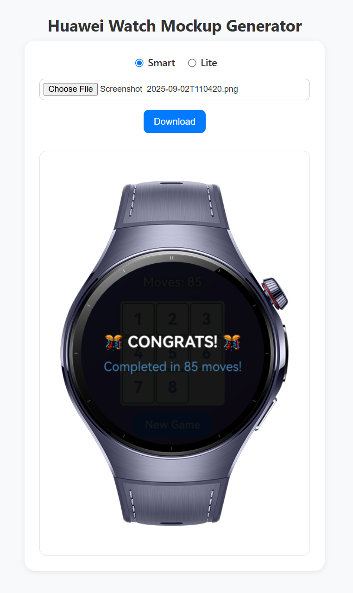
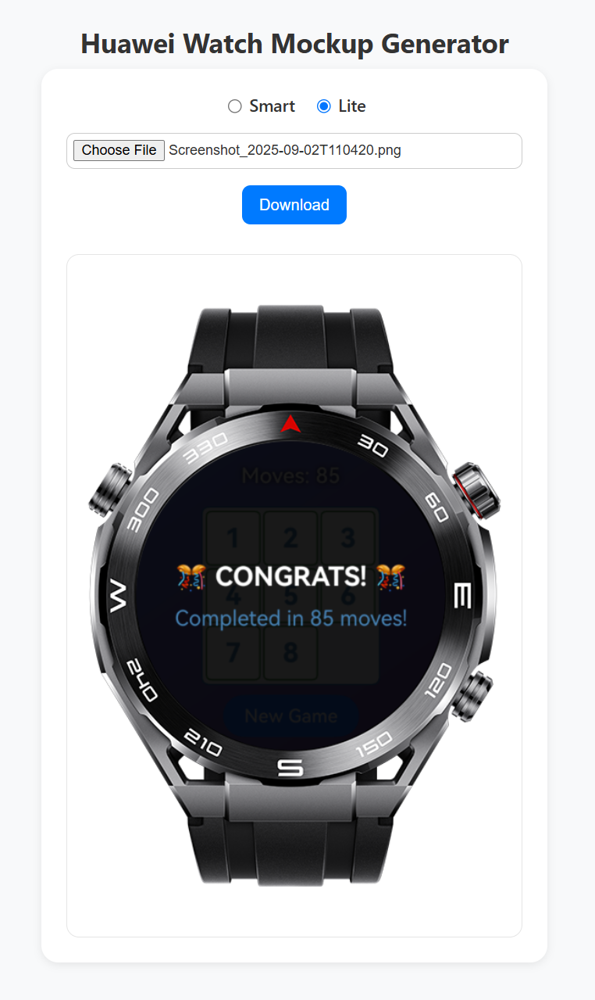

> **Note:** To access all shared projects, get information about environment setup, and view other guides, please visit [Explore-In-HMOS Index](https://github.com/Explore-In-HMOS/hmos-index).

# Huawei Watch Mockup Generator

This project provides user a web interface to upload their application screenshots and generate Huawei Watch mockup images.

It currently supports Watch 5 (Smart) and Watch Ultimate (Lite) devices.

  
  

